

  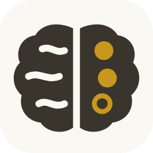

<h1 align="center">Life OS</h1>

  <b>A personal operating system designed as my second brain.</b> 
  To-dos, habits, calendar, projects, notes, a daily news briefing and a budget, 
  in one web app shaped around how I actually think and work. I use it every day.

  Built by directing an AI coding agent (Claude Code) · AI features powered by Claude · Next.js + Supabase · live on Vercel

> **In 30 seconds**
> - **The problem:** I outgrew Notion. My planning, habits, projects and notes lived in separate pages that couldn't talk to each other or get smarter.
> - **What I built:** one app for my whole day, with seven sections, a real database and login, Google Calendar, and a phone layout. It's deployed and I use it daily.
> - **How:** I acted as product owner and directed an AI coding agent: I scoped every feature, set the design rules, tested it on my own life and cut what didn't work.
> - **AI in the product:** four Claude-powered features (plain-English quick add, handwriting reading, a morning news paper, budget sorting), each built for low cost, human override and sending only the data it needs.

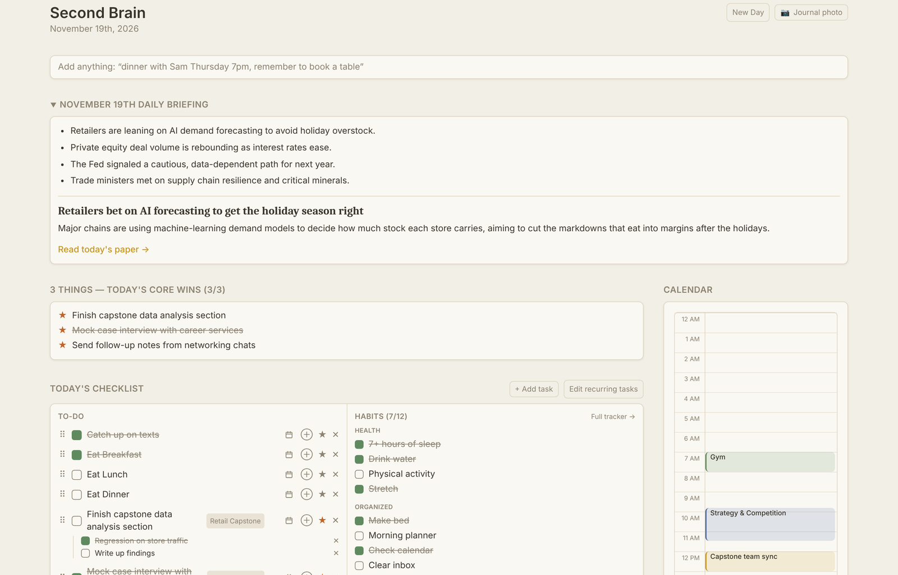

All screenshots use sample data.

| 7 | 4 | 26 | ~16,000 | 30+ |
| :---: | :---: | :---: | :---: | :---: |
| sections | AI features | database tables | lines of TypeScript | shipped iterations |

---

## Why I built it

I used Notion as my "second brain" for to-do lists, habits, project pages and
notes. Over time I outgrew it. Each part lived in its own page, every layout was
a compromise with what Notion allowed, and there was no way to add intelligence
where it would actually help.

I wanted one fully customizable place that followed how my brain works:

- **Start each day with a plan**, not a blank page: today's three priorities,
  my to-dos and habits side by side, my calendar, and a short read on the news.
- **Capture things the way they come to me**: a sentence typed in a hurry, or a
  page of handwriting in my paper planner.
- **Track habits and spending automatically**, with real stats instead of
  spreadsheets I maintain by hand.
- **Give every project and topic its own space**, connected to the tasks that
  move it forward.

## How I built it

I built Life OS by directing an AI coding agent, Claude Code. I didn't hand it
one big prompt; I ran it like a product owner running an engineering team:

1. **Scoped before building.** For every feature I set the requirements and the
   agent asked scoping questions before writing code. I made the product calls:
   what each screen shows, what gets cut, how it should feel.
2. **Built it one module at a time.** Home, To-Do List, Habit Tracker, Project
   Center, Deep Memory and Budget were each developed as their own workstream,
   so each could be finished and tested before moving on.
3. **Wrote the rules down.** [`CLAUDE.md`](CLAUDE.md) is the standing brief the
   agent reads at the start of every session: the decisions already made,
   design rules (no clutter, no browser pop-ups, everything must fit the
   screen), and the mistakes we'd already paid for, so they never happened
   twice.
4. **Tested it on my own life.** I used every feature daily, sent back
   screenshots and feedback, and iterated until it worked the way I wanted.
5. **Made design decisions that scale.** I decided project pages and notes
   pages should share one "workspace" design instead of being built twice. That
   one call means every improvement shows up everywhere.
6. **Cut what didn't earn its place.** I built an iMessage integration that used
   a local AI model to flag texts I needed to reply to. It worked, but it slowed
   my laptop down too much, so I removed it. I later took out an email panel
   too, to keep the home page focused. I also replaced my first journal reader
   (Google OCR plus hand-written parsing rules) once Claude could read the
   handwriting directly.
7. **Shipped it.** It runs on the web (Vercel) with a real database and login
   (Supabase), connects to Google Calendar, and has a phone layout so it works
   on my iPhone too.

The biggest takeaway: AI didn't replace the thinking. It let me go from a real
problem to a working product much faster, as long as I was clear about what I
wanted, what the AI should and shouldn't touch, and why.

## A tour

### Home: the Second Brain page
The home page is my daily dashboard: a **quick add** bar, the **daily
briefing**, today's **3 Things** (a hard cap of three priorities a day), to-dos
and habits side by side, and a **Google Calendar** day view where I can click
and drag to create events. **New Day** walks me through clearing yesterday's
leftovers, and **Journal photo** turns my paper planner into tasks.

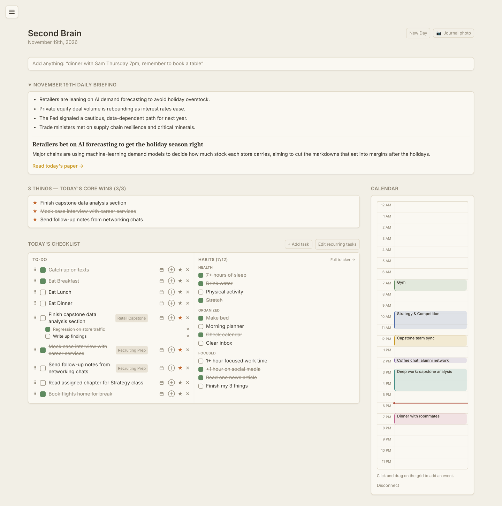

### The Daily Briefing
Each morning the app ranks headlines from sources I follow using keyword
scores that learn from my 👍/👎, then Claude writes them up as a short paper I
can read in five minutes.

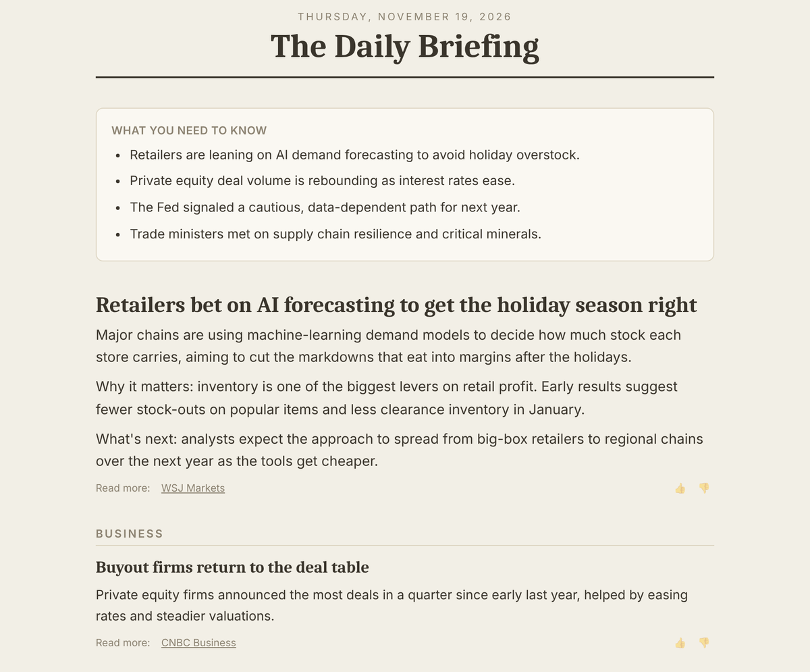

### Budget
Import a CSV from any bank or card (columns and sign conventions are detected
automatically), set a monthly budget per category, and track it with rings.
Supports split transactions, "paid back" for shared bills so only my share
counts, bulk delete, and one-click AI sorting.

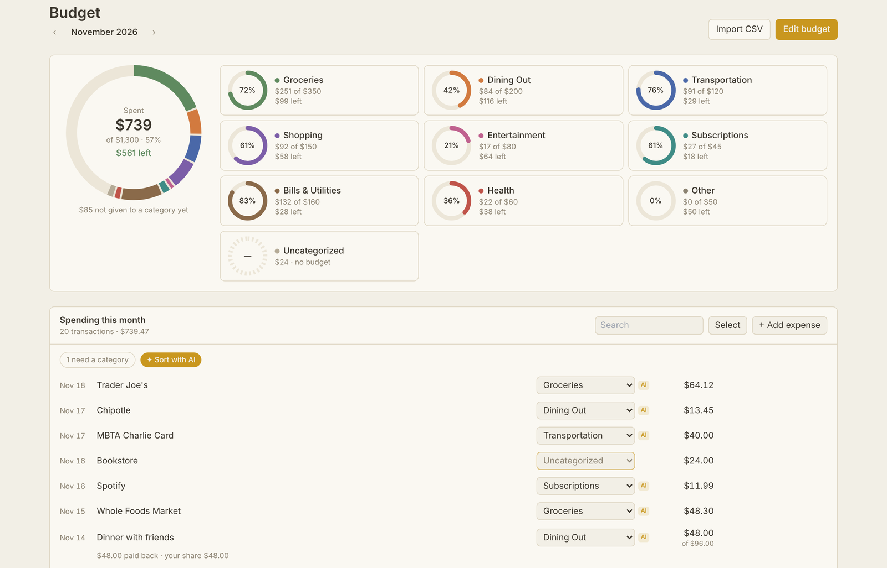

### To-Do List
A month calendar plus Today / Upcoming / Evergreen (no due date) / Overdue lists, subtasks,
recurring tasks (daily, weekly or yearly), and tasks tagged to projects.

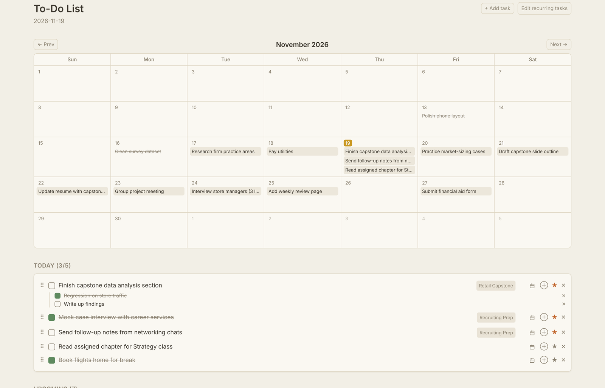

### Habit Tracker
Every habit by day, grouped by category, with month and all-time completion
rates and call-outs for the best habit and the one that needs work. A
**History** section keeps a card for every past month, grouped by year, with
its completion rate; open one to see that month's full grid and its best and
weakest habits, so I can look back at how any month went.

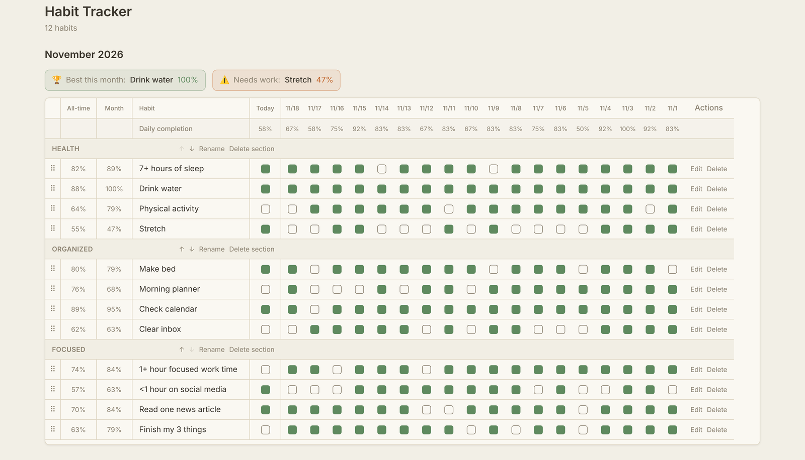

### Project Center
Every project as a card with a cover image, deadline and a progress bar driven
by its to-dos.

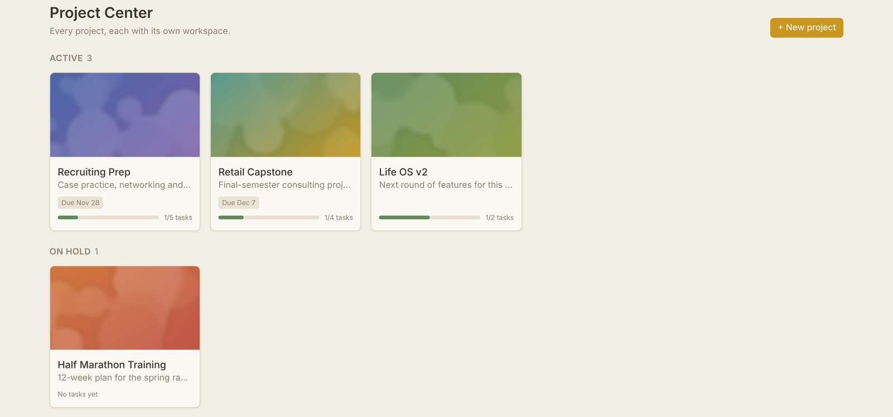

Each project opens into its own **workspace**: a drag-and-drop page of widgets
(linked to-dos, notes, checklists, tables, links, photo galleries, nested
sections) laid out however the project needs.

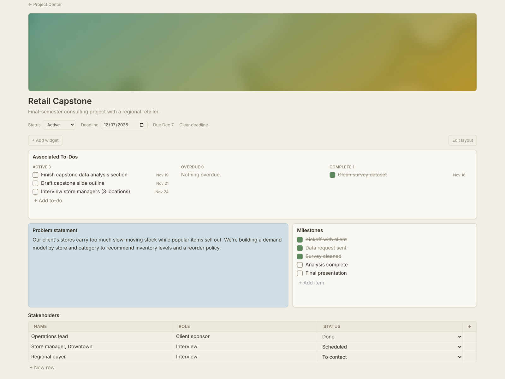

### Deep Memory
The place for the small details of life that are easy to forget: the concerts
I've been to, a physical therapy routine I want to keep doing, the recipes I
love. Pages are organized into categories on one board, and every page is the
same flexible workspace, so a physical therapy page can hold the PT's notes,
a checklist for each session, a table of exercises and links to how-to videos
in one view.

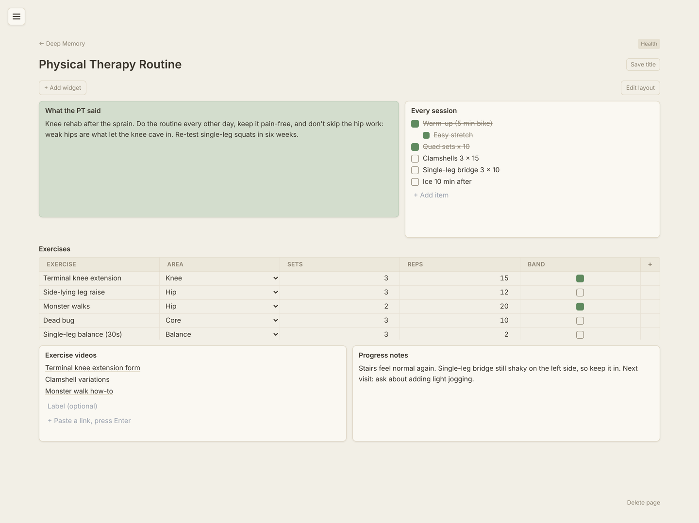

### On the phone
Every page adapts to a phone screen, and it can be added to the home screen
like an app.

  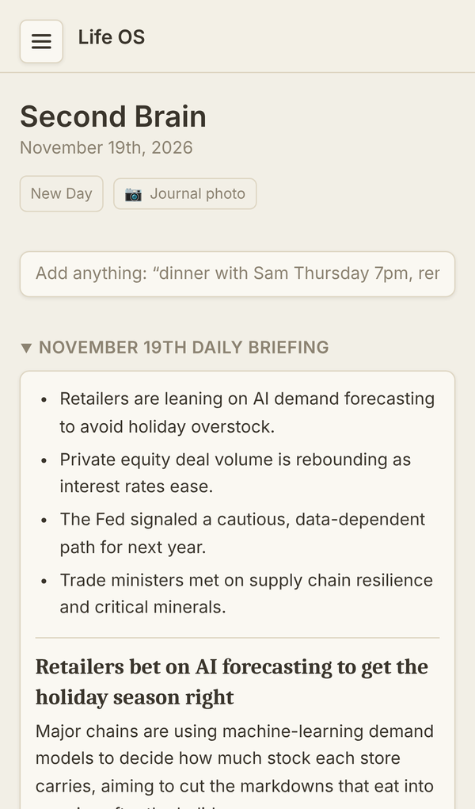
  &nbsp;
  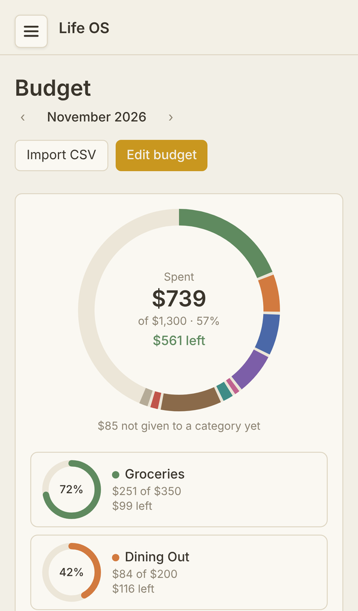

## Where AI helps, and where it doesn't

Owning the whole system meant I could add AI exactly where it saves time, and
keep it out everywhere else. Every AI feature follows three rules:

- **Cost control:** the right model for each job, and work is never paid for
  twice. The daily newspaper runs on a small, fast model for about $0.20 a
  month.
- **Human override:** AI suggests, I decide. Anything it does is visible,
  reversible, and my corrections always win.
- **Data minimization:** each feature sends only what it needs, never the
  rest of my data.

| Feature | What the AI does | What stays in my hands | What it sees |
| --- | --- | --- | --- |
| **Quick add** | Turns one plain-English line ("coffee chat Friday 2pm, prep 3 questions") into calendar events and to-dos | Everything it adds is listed right under the bar and can be edited or deleted | Only the typed line and today's date |
| **Journal photo** | Reads a photo of my handwritten planner page and pulls out my priorities and to-dos | Nothing is saved until I approve it on a review screen | Only that photo |
| **Daily newspaper** | Writes a short morning paper (key bullets, a lead story, sections) from the day's top headlines | *Which* stories make the cut is decided by my own 👍/👎 history, not the AI | Public news articles only |
| **Budget sorting** | Sorts merchants from my bank export into my budget categories | Each answer becomes a saved rule I can change; my own choices always override it; AI-sorted rows are tagged "AI" | Merchant names and category names only: no amounts, dates or accounts |

Because each budget answer becomes a rule, a merchant is only ever sent to the
AI once. After that, sorting it is free and instant.

## How it grew

Development happens in a private repository (it holds my real data and
settings); this is a cleaned public copy. The main milestones, in order:

1. **Foundation:** to-do list, daily schedule, 3 Things, projects, login and
   database.
2. **Daily rhythm:** recurring tasks, the New Day wizard, the habit tracker with
   stats, Google Calendar with click-and-drag events, the news briefing.
3. **The workspace:** Deep Memory pages, then one shared drag-and-drop canvas
   with nested sections, galleries, tables, linked to-dos, colors and styles,
   reused by Project Center.
4. **Going live:** deployed to Vercel next to the database, timezone-safe dates,
   instant checkboxes and faster page loads, a public privacy policy for Google
   sign-in.
5. **Focus:** cut the iMessage and email features, built a full phone layout.
6. **Budget and AI:** the Budget page with CSV import and AI sorting, then
   Claude-powered quick add, journal reading and the daily newspaper.

## Under the hood

| | |
| --- | --- |
| **Frontend** | Next.js 14 (App Router), React, TypeScript, Tailwind CSS |
| **Backend** | Supabase: Postgres database, authentication, file storage |
| **AI** | Claude via the Anthropic API, with structured (JSON schema) outputs; a smaller model where it's enough |
| **Hosting** | Vercel, in the same region as the database for speed |
| **Integrations** | Google Calendar (OAuth), RSS news feeds, bank/card CSV import |
| **Security** | Single user, no public sign-up; every table is locked to its owner with row level security; secrets stay out of the repo |

A few engineering choices worth calling out:

- **Fast by design.** The home page re-renders on nearly every click, so its
  database queries run in parallel, calendar results are cached briefly, and
  checkboxes update instantly while saving in the background.
- **A day that ends at 4am.** Late-night work still counts as "today", and all
  date logic runs in my timezone rather than the server's.
- **Explainable ranking.** News is ranked by keyword weights that adjust from
  my feedback, so I can always see why something ranked where it did. The AI
  only writes it up.

## Run it yourself

1. `npm install`
2. Create a free Supabase project, run [`supabase/schema.sql`](supabase/schema.sql)
   in its SQL editor, and add a user under Authentication → Users.
3. Copy `.env.local.example` to `.env.local` and fill in your values. The Anthropic
   key powers the AI features; Google Calendar is optional.
4. `npm run dev` and open http://localhost:3000.
